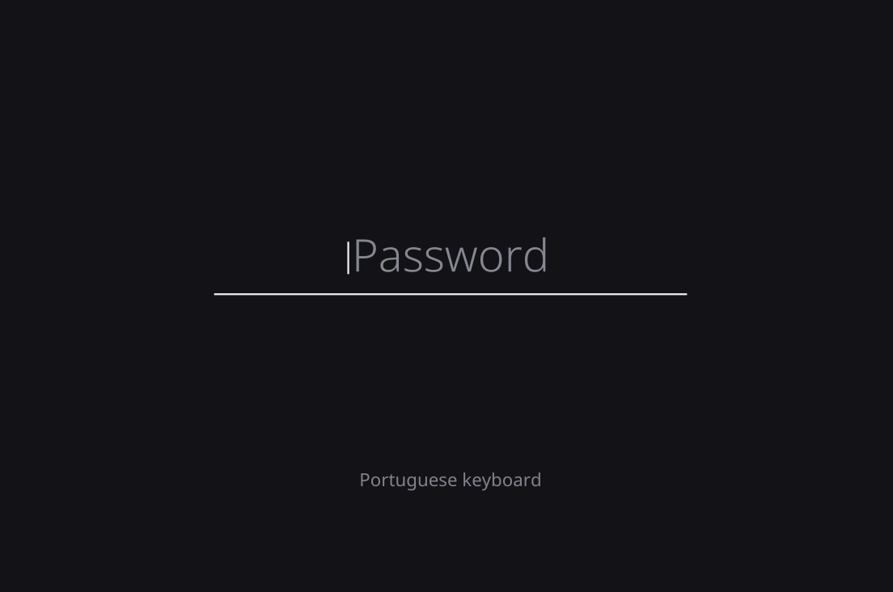

# paclock
**Lean screen locker, but with the right features for humans.**



* **Keyboard layout:** choose another layout on the lock screen, in case you got into the session with the wrong one. Dead keys and compose sequences work in the password.
* **Localization:** all texts go through gettext, and are drawn right in every script: shaped, and in the right order for right-to-left text. English and Portuguese, Spanish, French, German, Italian, Russian, Arabic, Persian, Hebrew, Hindi, Bengali, Thai, Japanese, Korean and Chinese (simplified and traditional); all but English are machine-written and not yet reviewed by native speakers. Add a language with a `.po` file in `po/`. See [platform](docs/platform.md#text-in-other-scripts).
* **Accessibility for the visually impaired:** speech through speech-dispatcher, high contrast, and text you can scale (`text_scale`) or limit by real size (`text_size_min = 3mm`, `text_size_max`).
* **Useful feedback:** it says what to do ("Enter your password") and what happened (a refused password, Caps Lock, "Checking…"), in words and by speech.
* **Less information leakage:** `privacy` levels hide the username, the layout and the password field, and at `paranoid` the length of the password; from `medium` they also pause the media players and mute other sound while locked.
* **Light, and only what you use:** C, Cairo, FreeType, xkbcommon and PAM; no GTK or Qt. Optional features can be turned off in the settings, and speech, translations and the layout choice can be left out of the build (`SPEECH=none`, `I18N=0`, `LAYOUTS=0`). `resources = low` or `minimal` uses less memory.
* **No setup:** it works out of the box, and looks like [pacgreet](../pacgreet).

## Quick start

```bash
make && sudo make install
paclock
```

The shared code is the `pacommon` submodule: clone with `--recurse-submodules` (or run `git submodule update --init`), or set `PACOMMON=` to another checkout.

`make install` also puts `/etc/pam.d/paclock` in place, which says what the password is checked against (`auth include system-auth` on Arch and Fedora, `common-auth` on Debian and Ubuntu, chosen at install time from what is in `/etc/pam.d`; `make install PAM_STACK=name` overrides it: the same as logging in). Edit it if your distribution calls that differently. **paclock refuses to lock if the file, or the stack it includes, is missing**, because PAM would then refuse every password.

Needs a compositor with `ext-session-lock-v1`, viewporter and single-pixel-buffer. It was run on sway and Hyprland (the author's); others that have the protocols should work, but are untested ([platform](docs/platform.md)). To try it without locking anything, inside your own session: `paclock --demo` (a fullscreen window; password `demo`; Esc leaves).

## Build options

| Option | Default | |
|---|---|---|
| `I18N=1` | on | translated texts (gettext). `I18N=0` builds an English-only binary and installs no catalogs. |
| `LAYOUTS=1` | on | the choice of keyboard layout under the password. `LAYOUTS=0` builds without it: only the compositor's keymap is used, and `layouts` in the config is ignored. |
| `SPEECH=speechd` | on | speaks the messages through speech-dispatcher (libspeechd). `SPEECH=none` links no speech library. `atspi` is not supported. The speech code is shared, in pacommon's `speech.[ch]`. |

## Trying it safely

A locker that dies while the screen is locked leaves you locked out, so test changes in this order:

1. **`paclock --demo`**: a window, not a lock. It checks drawing and typing, but **not the lock itself**: it never creates a lock surface, so lock-only bugs (such as a protocol error that kills the client) do not show up.
2. **A nested compositor**: the real lock, but only on a throwaway window. wlroots compositors (sway, labwc) run as a window inside your session:
   ```bash
   cat > /tmp/lock-test.conf <<'EOF'
   exec sh -c './paclock > /tmp/lock-test.out 2>&1; echo "exit=$?" >> /tmp/lock-test.out'
   EOF
   WLR_BACKENDS=wayland timeout 20 sway -c /tmp/lock-test.conf
   cat /tmp/lock-test.out
   ```
   Run `./paclock` from the build directory, not the installed one. If it is still running after a few seconds with nothing in the output, it locked. A compositor error such as `session lock surface is committed with a null buffer` appears here instead of locking your real screen. (`exit=1` with no message after `timeout` ends sway is normal: the compositor went away.)
3. **The real session, with a way out ready**: before the first run, know how to recover (below), and keep a TTY in mind (Ctrl+Alt+F3).

### If you are locked out (a red screen)

The compositor is holding the lock for a locker that is gone. Do not reboot:

* **Hyprland**: from a TTY,
  ```bash
  hyprctl --instance 0 'keyword misc:allow_session_lock_restore 1'
  hyprctl --instance 0 'dispatch exec hyprlock'   # or: paclock
  ```
  If `hyprctl` cannot find the instance, set `HYPRLAND_INSTANCE_SIGNATURE=$(ls /run/user/$UID/hypr | head -1)` first.
* **Other compositors**: from a TTY, start another locker with `WAYLAND_DISPLAY` set (usually `wayland-1`), or `pkill` the compositor to end the session.

Bind it to a key, or run it from an idle daemon, e.g. in sway: `swayidle -w timeout 300 paclock before-sleep paclock`.

### The audio stopped working after a failure

If `mute_streams` (or `privacy = medium` or higher) was on and paclock was killed or crashed, the sound it muted stays muted, and the players it paused stay paused: nothing undoes it while the session is locked, on purpose. Once you are back in the session, open the Volume Controller (first check that one is installed: `pavucontrol` for PulseAudio and PipeWire, for example), go to **Playback** and unmute the app. Press play in a player that was paused. Without a volume controller, `pactl set-sink-input-mute ID 0` does the same; the other commands are in [docs/session.md](docs/session.md).

## Keys

| Key | |
|---|---|
| Enter | unlock |
| Backspace, Ctrl+Backspace or Ctrl+U | delete a character, clear the field |
| Esc | clear the password and any message |
| Tab or Down | choose another keyboard layout: type to search, Left and Right step, Enter picks, Esc leaves. Ctrl+Space (or Super+Space) goes to the next one. Not there when there is only one, and not at `resources = low` or `privacy = high` |

Dead keys and Compose work. A yellow note appears when Caps Lock is on ("Caps Lock is on:" and, on a second line, "Your password might not be accepted."; the same is spoken). Every screen shows the same field; a screen plugged in while locked is covered at once.

```
paclock [-C CONTRAST] [-l LANGUAGE] [--config FILE] [--demo]
```

## Configuration

Everything works without any. paclock reads `/etc/pac/paclock.conf`, then `~/.config/pac/paclock.conf` (or `$XDG_CONFIG_HOME/pac/paclock.conf`), then `paclock.conf` in the current folder, each overriding the earlier: one `key = value` per line, `#` starts a comment, bad lines are reported on stderr and skipped. [`paclock.conf`](paclock.conf) lists every option.

| Config key | Option | |
|---|---|---|
| `contrast` | `-C` | `normal`, or `high`: black and white, nothing dimmed |
| `text_scale`, `font`, `font_light` | | size (1 is the same real size on every screen: the password is about 12 mm high; a screen that does not report its size gets text in proportion to its height), and font files |
| `text_size_min`, `text_size_max` | | limits on the smallest text, as a number with a unit: `mm`, `in`, `pt`, `px` or `%` of the screen's shorter side, e.g. `3mm`. mm, in and pt use the screen's own size (96 dpi if it does not say); no limit by default |
| `privacy` | | `normal` (default), `medium` (pause the players and mute other sound while locked), `high` (also: no username or layout choice, no password field until the first key, only "Enter your password" and what goes wrong) or `paranoid` (also: a full row of dots whatever the password length). Never changes contrast or speech, and wins over `resources`: `medium` runs `busctl` and `pactl` even at `resources = minimal`. Can be set for every pac tool in `pac.conf` |
| `show_user` | | show the username, small and dim, above the password (off by default: whoever is at the screen can read it) |
| `resources` | | `normal` (default), `low` (no username or layout choice) or `minimal` (also a small card: only the password line and its message, everything 0.7 times the size). Can be set for every pac tool in `pac.conf`, together with `text_size_min`, `text_size_max`, `contrast`, `speech` and `privacy`; paclock's own file wins. Never changes contrast, speech or the size limits. See [pacommon/docs/configuration.md](pacommon/docs/configuration.md) |
| `speech` | | `yes` (default) or `no`: say the messages of the card aloud, and "Unlocked", for people who cannot see the screen: [docs/messages.md](docs/messages.md) lists them all, including the lockout and Caps Lock ones. Never the password or what is typed. Needs speech-dispatcher running, else paclock says so and stays silent |
| `lock_hint`, `pause_players`, `mute_streams` | | `no` (default) or `yes`, each once the screen is locked, undone on unlocking: tell logind the session is locked (`busctl`, `LockedHint`), pause the playing MPRIS players (`busctl`) and play them again, mute other programs' sound but not speech-dispatcher's (`pactl`). A missing program is said once and skipped; a stream that starts while locked is not muted. Not done by `--demo`. See [docs/session.md](docs/session.md) |
| `language` | `-l` | the language of the texts, e.g. `pt`; overrides the environment's |

`make test` runs the unit tests. Translations work as in pacgreet (gettext, domain `paclock`, `po/`); the catalogs are listed above.

## Security

* **The lock is the compositor's.** paclock only asks for it (`ext-session-lock`): while locked, the compositor shows nothing but paclock's surfaces and sends input nowhere else. If paclock crashes or is killed, **the screen stays locked** (switch to a VT and log in to run another locker or restart the compositor), and what it did to the audio stays done ([audio](#the-audio-stopped-working-after-a-failure)). Only the right password lets go of the lock.
* The password is checked by PAM in a separate thread, as the user who runs paclock; it is wiped after use and kept out of core dumps. Only a password prompt can be answered: a one-time code or fingerprint in the PAM stack makes the check fail. The account is not checked (`pam_acct_mgmt`): an expired or locked account with the right password still unlocks, see [decisions.md](docs/decisions.md).
* **Speech says only what is on the screen.** The messages go to the user's speech-dispatcher; the password and the keys typed never do. The connection is opened before the screen is locked, and a missing server only means silence. `speech = no` (or `SPEECH=none`) opens no connection.
* **Optional, off by default:** `lock_hint`, `pause_players` and `mute_streams` (the last two are also turned on by `privacy = medium` and above) run `busctl` and `pactl` (found in `PATH`, no shell, killed after a second) to quiet the rest of the session; nothing is sent anywhere else.
* If another locker is running, or the compositor lacks the protocol, paclock says so and does not pretend to lock.

## What it stores

Nothing. paclock writes no file: it reads its configuration, and keeps the password in memory only until it has been checked, then wipes it.

## Size

The binary is 83 KiB stripped with the default options (`make`, GCC `-Os -flto`, packed relocations where the system supports them; it links HarfBuzz and FriBidi for the scripts) and 71 KiB with `SPEECH=none I18N=0 LAYOUTS=0` (English only, neither library). A real lock at `resources = minimal` in that build uses about 1.4 MB of proportional memory (PSS), and about 2.4 MB by default; for reference, swaylock's blank screen uses about 1.2 MB and hyprlock about 58 MB. The numbers are not a goal: paclock is made to be easy to use first. How they were measured, and what was not, in [docs/platform.md](docs/platform.md#compared-with-swaylock-and-hyprlock-for-reference-2026-11-16).

## More

- [Messages](docs/messages.md): what the card says and what is said aloud
- [The session while locked](docs/session.md): pausing players and muting sound, and undoing it by hand
- [Platform](docs/platform.md): what assumes Linux, and what was run
- [Decisions](docs/decisions.md): why it is the way it is
- [Contributing](CONTRIBUTING.md)

## AI Assistance Disclosure

The tools were Claude (code generation), Dropstone (review and improvement), and Gemini and ChatGPT (investigation), as [the principles](pacommon/PRINCIPLES.md#ai-assisted-human-owned) describe. They were used during the development of paclock for:

- Architecture & Ideation: Discussing design trade-offs (e.g., C-first philosophy, avoiding heavy dependencies, and leveraging Wayland protocols).
- Quality & Security Auditing: Reviewing code for correctness, safety, and reliability.
- Code Refinement: Structuring low-level Wayland, Cairo and input-handling calls.
- Documentation & Localization: Drafting documentation and initial translation catalogs (po/).

All code was reviewed, tested, and curated by the human author to ensure performance, security, and minimal overhead.

## License

MIT, see [LICENSE](LICENSE).
